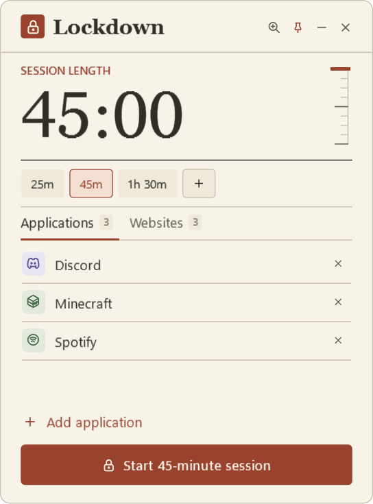
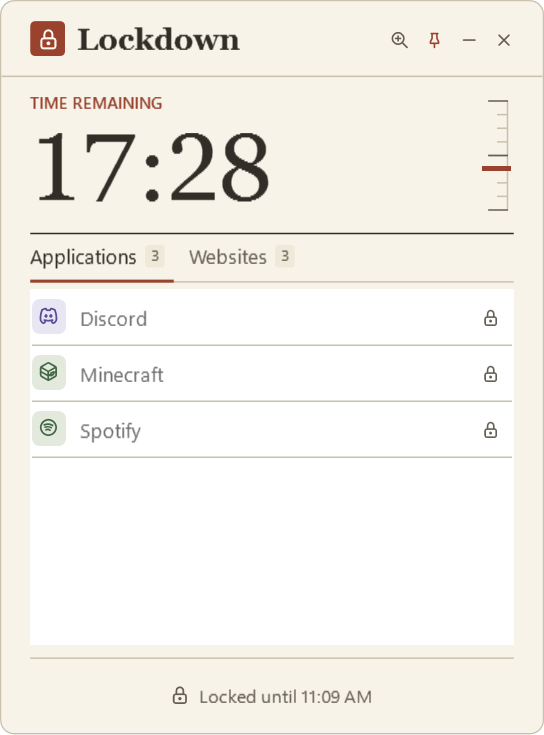
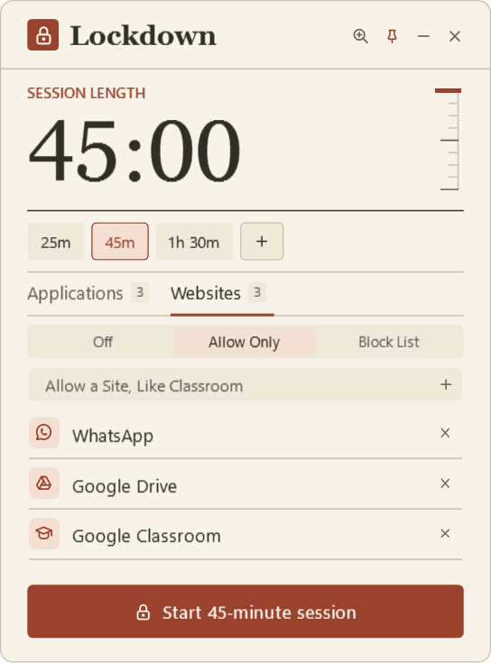
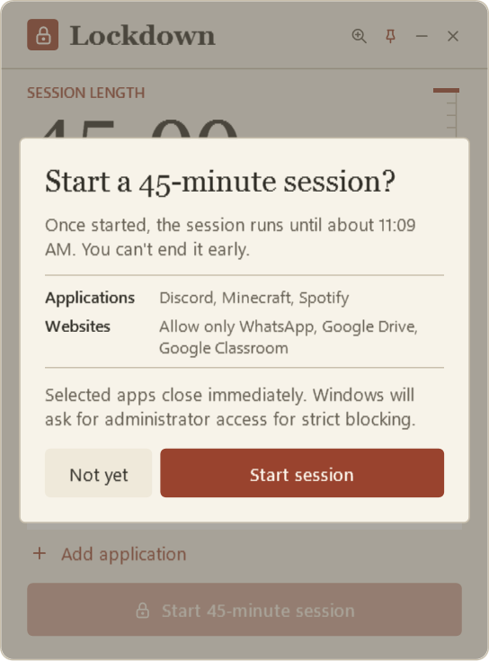
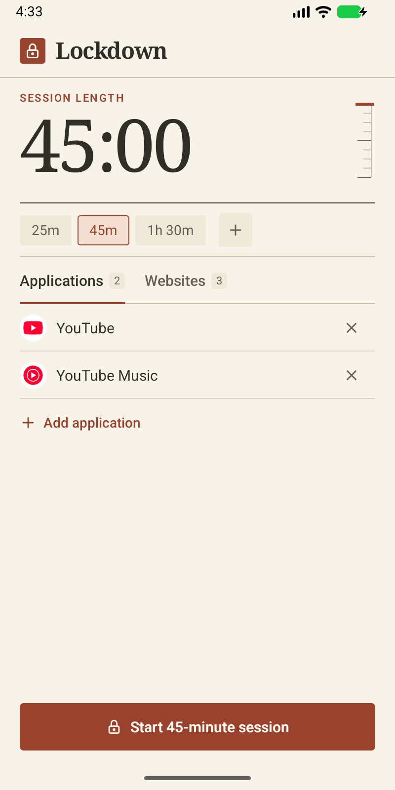
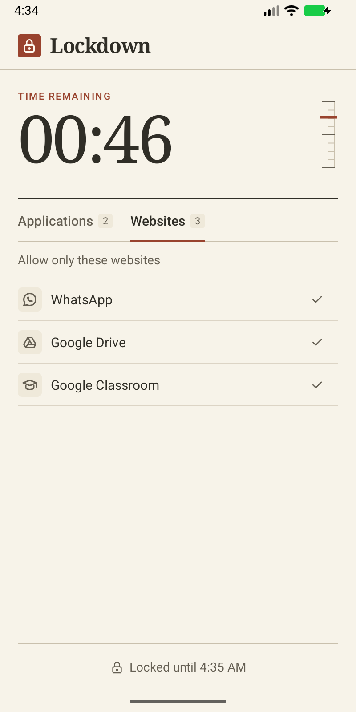
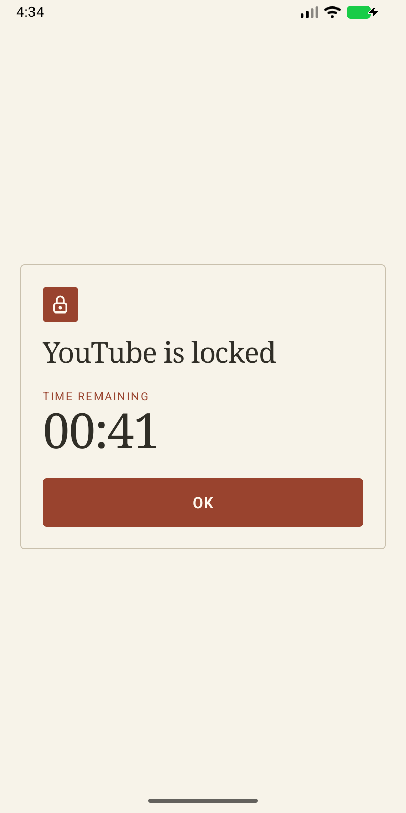

# Lockdown

Lockdown blocks the apps and websites you choose for a timed focus session on Windows and Android. Its **Folio** interface puts a large serif timer beside a ruled gauge. During a session, the gauge tracks the time remaining and the footer shows when your apps and sites unlock.

## Windows

Choose a duration, review what will be blocked, and start the session. You can pin the compact window above your work or follow the countdown from the tray.

| Set up a session | Follow the countdown |
|:---:|:---:|
| [](docs/idle.png) | [](docs/locked.png) |
| **Choose website rules** | **Review before starting** |
| [](docs/websites.png) | [](docs/start.png) |

## Features

- **Lock applications:** pick from your installed apps or any `.exe`. Locked apps close the moment they open.
- **Lock websites:** either **Allow Only** (block everything except your list) or **Block List** (block only your list). Type a name like `youtube` and every domain that site uses is covered.
- **Strict mode:** sessions can't be ended early, and the usual workarounds don't work (see below).
- **Your own session lengths:** use a preset or enter a duration such as `25`, `45`, or `1h30`. The window remembers its size on each monitor.

## Getting started

Requires Windows 10 or 11. Strict mode and website blocking need an administrator account (one Windows prompt per session).

1. Download or clone this repository.
2. Double-click **`Lockdown.bat`** once. It builds `Lockdown.exe` from [`Launcher.cs`](Launcher.cs) with the C# compiler built into Windows, then starts the app.
3. After that, open **`Lockdown.exe`**. To pin it, right-click its taskbar button while it's running.

No prebuilt binary is included: `Lockdown.exe` is a small launcher compiled on your PC so the app starts without a console window. You can also run `Lockdown.ps1` directly with PowerShell.

## Strict mode

When a session starts, Lockdown sets up a hidden scheduled task, **Lockdown Guard**, that runs as `SYSTEM` and does the locking until time is up. Then it removes itself.

| If you try to... | What happens |
|---|---|
| Close or kill Lockdown | Nothing. Apps stay locked. |
| End the guard in Task Manager | A normal user can't. If an admin does, Windows restarts it within a minute and adds the lost time back. |
| Restart the PC or change the clock | The guard resumes at boot and counts uptime, not clock time. |
| Edit Lockdown's settings | Ignored. Session state lives in an admin-only folder. |
| Rename a locked `.exe` | Still closed (matched by its built-in original name). |
| Delete the browser rules | The guard puts them back. |

If you decline the admin prompt, you get a **basic session** instead: apps are locked by the window itself and websites aren't blocked.

As an administrator you can still remove the guard on purpose. Strict mode makes quitting a deliberate effort, not a single click.

## Browsers

- **Chrome, Edge, Brave, Chromium and Firefox** follow your website rules. Firefox is restarted at the start of a session so the rules apply, and your tabs come back.
- **Opera, Opera GX, Vivaldi, Arc, Zen, LibreWolf, Waterfox, Floorp, Pale Moon, Basilisk, SeaMonkey, DuckDuckGo, Thorium, Yandex, Maxthon, Slimjet, Iridium, CatsXP and Internet Explorer** ignore website rules, so they're closed for the whole session.
- Browsers built into other apps, renamed portable browsers and Tor Browser aren't covered. Add them under **Applications** to close them.

## Cleanup

Lockdown removes everything it sets up when a session ends, and offers to clean up next time you open it if a session was interrupted.

<details>
<summary>What it changes, and how to remove it by hand</summary>

| Where | What |
|---|---|
| `%APPDATA%\Lockdown` | Your settings |
| `C:\ProgramData\Lockdown` and the scheduled task `Lockdown Guard` | The guard, during a strict session |
| `HKLM\SOFTWARE\Policies\` for Chrome, Edge, Brave, Chromium (`URLBlocklist`, `URLAllowlist`) and Firefox (`WebsiteFilter`) | Website rules, during a session |
| `Lockdown.lnk` in the Startup folder | Reopens the window after a reboot, during a session |

Run in an **administrator** PowerShell:

```powershell
Unregister-ScheduledTask -TaskName 'Lockdown Guard' -Confirm:$false -ErrorAction SilentlyContinue
Remove-Item "$env:ProgramData\Lockdown" -Recurse -Force -ErrorAction SilentlyContinue
foreach ($k in 'Google\Chrome', 'Microsoft\Edge', 'BraveSoftware\Brave', 'Chromium') {
    Remove-Item "HKLM:\SOFTWARE\Policies\$k\URLBlocklist", "HKLM:\SOFTWARE\Policies\$k\URLAllowlist" -Recurse -Force -ErrorAction SilentlyContinue
}
Remove-Item 'HKLM:\SOFTWARE\Policies\Mozilla\Firefox\WebsiteFilter' -Recurse -Force -ErrorAction SilentlyContinue
```

</details>

## Android

On Android 8 or newer, Folio uses the same timer, duration presets, and Applications and Websites tabs. Opening a locked app shows its name and how much time remains.

| Set up a session | Active session | Open a locked app |
|:---:|:---:|:---:|
| [](docs/android-ready.png) | [](docs/android-locked.png) | [](docs/android-blocked.png) |

**Build and install.** With the Android SDK installed, run `.\gradlew.bat assembleRelease` on Windows or `./gradlew assembleRelease` on macOS or Linux from the [android](android) folder. Copy `android/app/build/outputs/apk/release/app-release.apk` to your phone and open it.

**Turn it on:** the first time you press Start, Lockdown asks you to turn it on in **Settings → Accessibility**. If Android says it's a *restricted setting*, open **App Info → ⋮ → Allow restricted settings**, then try again.

During a session:

- Locked apps go straight back to the home screen.
- **Chrome, Edge, Brave, Samsung Internet, Firefox, Opera, Vivaldi, Kiwi and DuckDuckGo** follow your website rules: Lockdown reads the address bar and steps back from blocked sites. Every other browser is locked for the session.
- Lockdown's App Info, accessibility page and uninstall screen stay shut, so it can't be force-stopped, turned off or removed until time is up.
- Time is counted on the phone's uptime, so changing the clock doesn't help, and after a restart the session carries on.
- The home screen, Settings and the Phone app can't be locked.

Android only lets an app do this through its accessibility service, which can still be bypassed with a computer (`adb`) or by booting into safe mode. Browsers built into other apps aren't covered.

## Credits

Icons from [Tabler Icons](https://tabler.io/icons), Copyright (c) 2020-2024 Paweł Kuna, MIT licence.
